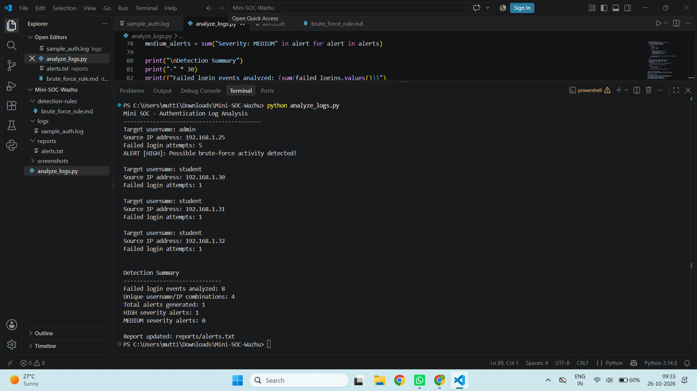
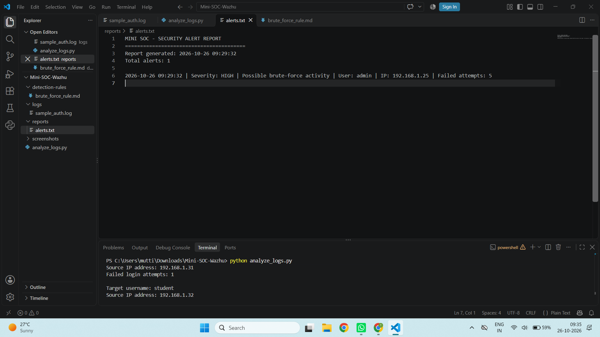

# Mini SOC - Security Monitoring and Threat Detection

## Project Overview

This project is a beginner-friendly Security Operations Center (SOC) prototype built using Python. It analyzes sample authentication logs, detects repeated failed login attempts, assigns alert severity, and generates a security alert report.

## Objectives

- Analyze authentication log entries.
- Detect possible brute-force login activity.
- Identify the username and source IP address involved.
- Assign MEDIUM or HIGH severity based on failed login counts.
- Generate a readable security alert report.

## Tools Used

- Python 3
- Visual Studio Code
- Sample authentication logs
- Windows
- Git and GitHub

## Detection Logic

- Group failed login attempts by username and source IP address.
- Generate an alert when the count reaches 3 or more.
- Assign MEDIUM severity for 3–4 failed attempts.
- Assign HIGH severity for 5 or more failed attempts.
- Save the results to `reports/alerts.txt`.

## Project Structure

- `analyze_logs.py` - Python log analysis and alert generation.
- `logs/sample_auth.log` - Fictional authentication log entries.
- `detection-rules/brute_force_rule.md` - Detection rule documentation.
- `reports/alerts.txt` - Generated security alert report.
- `screenshots/` - Project output screenshots.

## Test Results

The project was tested with fictional authentication logs containing repeated failed login attempts.

- Three failed attempts from the same username and IP generated a MEDIUM alert.
- Five failed attempts from the same username and IP generated a HIGH alert.
- The generated report includes a timestamp, alert severity, username, source IP, and failed-attempt count.

## Screenshots

### Terminal Output

### Security Alert Report

## Limitations

This is a local Python-based prototype that analyzes sample logs. It does not currently monitor live systems or deploy detection rules inside Wazuh.

## Future Improvements

- Integrate with Wazuh for security event monitoring.
- Analyze real authentication logs in a controlled lab.
- Add additional detection rules.
- Improve alert investigation and reporting.

## Author

Cybersecurity Learning Project